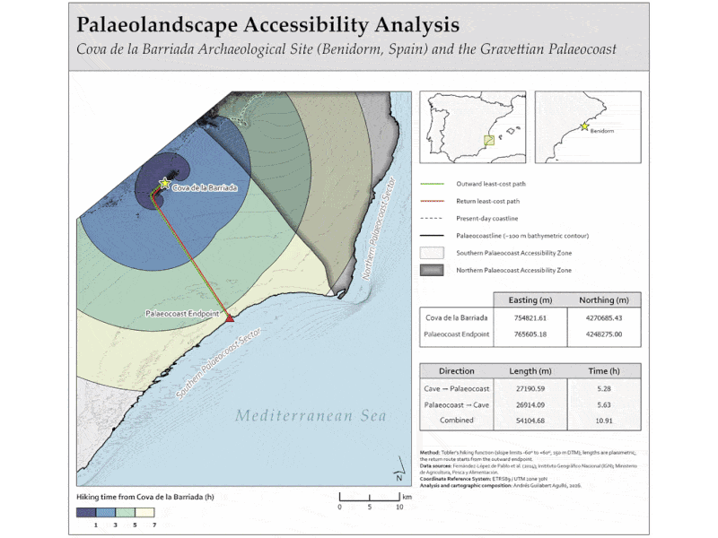

# Reproducible Least-Cost GIS Workflow: Cova de la Barriada

A **parameterised ArcGIS Pro Notebook workflow** combining terrain modelling, least-cost analysis and automated cartographic production to investigate potential access to a palaeocoast near Cova de la Barriada, Benidorm, Spain.

## Workflow in Action

The animation illustrates how changing analysis parameters affects map outputs, followed by a brief demonstration of parameter editing in the notebook.

## Notebook

[**View the complete ArcGIS Pro workflow →**](Cova_Barriada_Least_Cost_Analysis.ipynb)

## Project Overview

### Case Study: Cova de la Barriada (*Barriada Cave*)

Archaeological evidence from Cova de la Barriada includes abundant remains of the land snail *Iberus alonensis*, interpreted as evidence of dietary diversification during the Early Upper Palaeolithic ([Fernández-López de Pablo et al., 2014](https://journals.plos.org/plosone/article?id=10.1371/journal.pone.0104898)). With sea level approximately **100 m below its present position**, the Mediterranean coastline lay considerably farther from the cave than it does today.

Using official topographic and bathymetric data, the project models potential access from the cave to a predefined palaeocoast approximated by the −100 m bathymetric contour. Least-cost analysis compares travel costs to two coastal sectors, identifying the more accessible sector, its **Palaeocoast Endpoint** and the corresponding route from the cave.

### Technical Design: Automation and Reproducibility

The workflow is implemented in an **ArcGIS Pro Notebook using ArcPy**, with centralised parameters, project-relative paths and a dedicated staging geodatabase to support repeatable processing and structured data management.

Three key settings can be adjusted: DTM cell size, slope-angle limits for Tobler-based hiking-time modelling, and travel-time thresholds for isochrone generation. The notebook also automates the generation of intermediate figures and the final map layout, keeping cartographic outputs consistent with the analytical results.

The modular, parameterised design provides a foundation for extending the analysis to alternative terrain or bathymetric inputs and additional environmental cost factors.

## Technical Highlights

- **GIS automation:** ArcPy-based processing in ArcGIS Pro.
- **Terrain analysis:** DTM generation, distance accumulation and optimal path modelling.
- **Travel-time modelling:** Tobler's hiking function, isochrones and coastal accessibility zonation.
- **Reproducible mapping:** Parameter-driven outputs and automated map layout generation.
- **Structured data management:** Project-relative paths and a dedicated staging geodatabase.

## Tools

ArcGIS Pro · ArcPy · Python · Spatial Analyst

